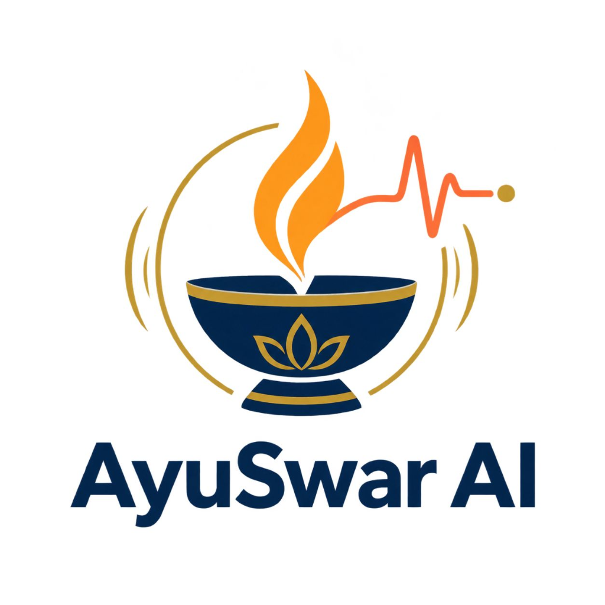
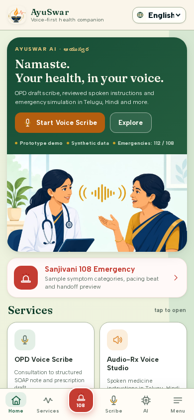
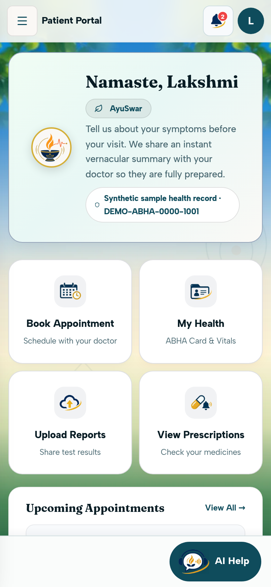
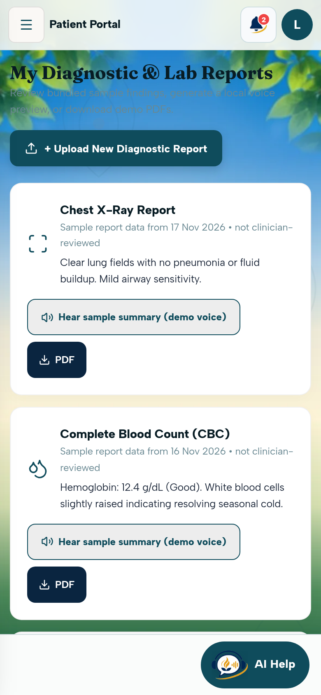
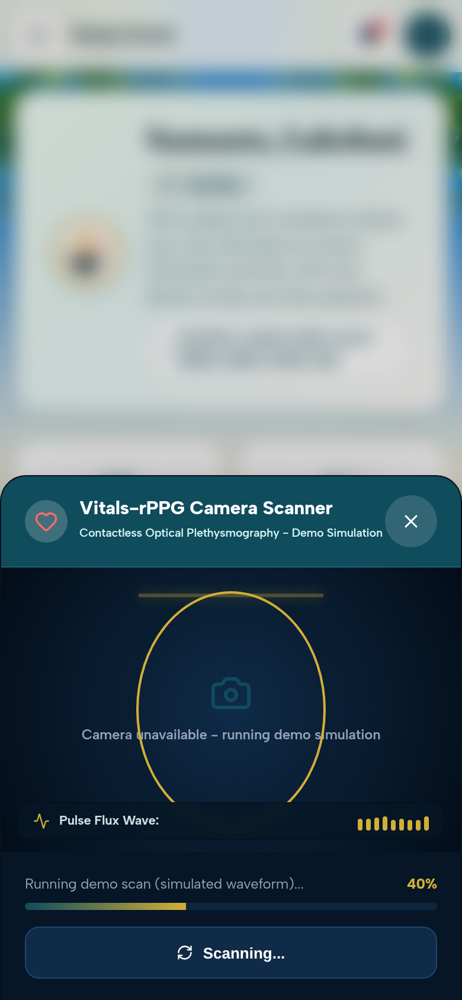
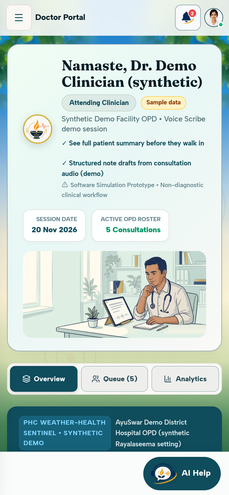
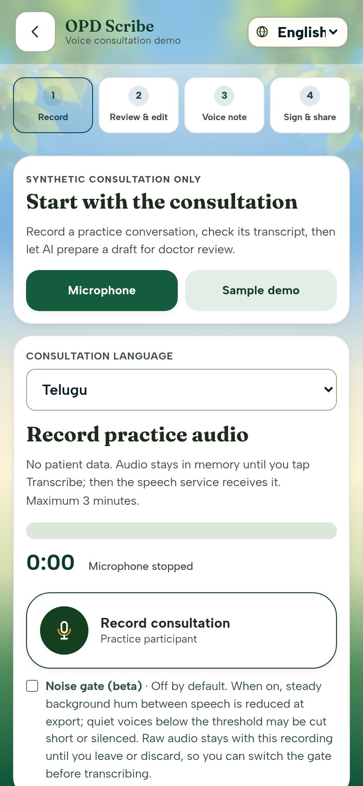
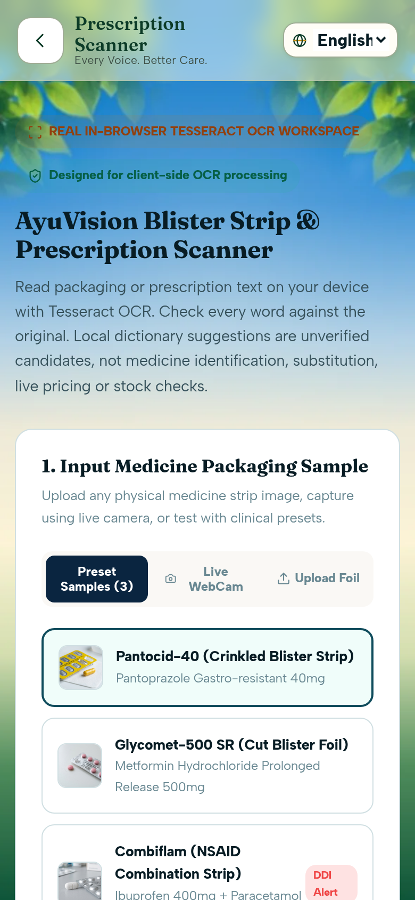
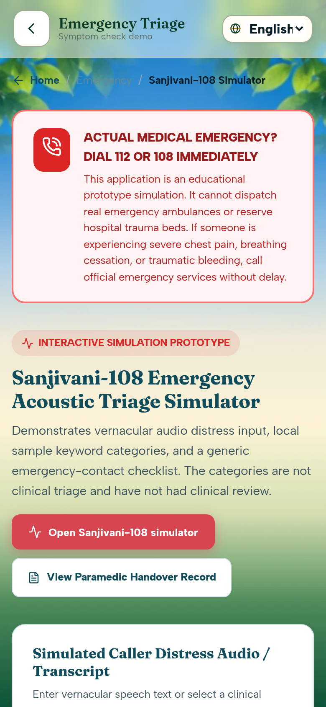

<div align="center">



# AyuSwar AI - Mobile

### Synthetic-data Indic healthcare voice prototype, now as an Android app

<a href="https://readme-typing-svg.herokuapp.com">
  
</a>

-0F4C5C)

%20%2B%20web-D97706)


</div>

---

AyuSwar AI is a Telugu-first, synthetic-data healthcare voice prototype built by [Satya Samrudh Dwivedula](https://github.com/Samrudh2006) (Aditya University). This repository is the **mobile build**: the full AyuSwar web experience packaged as an Android app with Capacitor, with a mobile-native lens across every screen.

> **Honesty first.** This is a research prototype. All bundled sample data (patients, reports, vitals, clinicians and consultations) is synthetic, and the app is for demo use only. Nothing here diagnoses, dispatches, exchanges with ABDM, or is production-ready. Where something is a simulation, the app says so on screen.

---

## ✨ What is inside

| | Module | What it does |
|---|---|---|
| 🩺 | **Clinical scribe (Sanjivani)** | Ambient OPD consultation drafting with vernacular support and FHIR-shaped local JSON drafts |
| 💊 | **Blister & Rx scanner (AyuVision)** | Real on-device Tesseract OCR of medicine strips; local dictionary candidates clearly marked unverified |
| 🔊 | **Audio-Rx Studio** | Spoken medicine instructions in Telugu, Hindi and English (speech availability depends on the voice provider and device), with timed word-by-word karaoke highlighting |
| 👤 | **Patient portal** | Health records, appointments, medicine schedule, vitals tracker and report organizer with local persistence |
| 🧑‍⚕️ | **Doctor portal** | Consultation review, Rx lens, handover workflows |
| 🚨 | **Emergency triage (simulated)** | Sanjivani 108 handoff rehearsal; clearly simulated, no real dispatch |
| 🎙️ | **Acoustic lab** | Non-diagnostic voice signal exploration in the browser |
| 🌐 | **Indic language matrix** | Telugu, Hindi, Indian English interface locales with dialect examples |

---

## 📱 Screenshots

<p align="center">
  
  
  
  
</p>
<p align="center">
  
  
  
  
</p>

<sub>Local-preview captures at 390×844 from an earlier 18 Nov 2026 revision; they predate that day's scanner/report honesty fixes and do not depict them. Native-device captures are on the roadmap below.</sub>

---

## 🎬 Patient video guides (Telugu voice-over, English captions)

Tap a title to open the video:

1. **[Portal & language tour](https://github.com/user-attachments/assets/7e5b7441-c180-47e1-9489-91ee187f8255)** - navigating the patient portal in your language
2. **[Your health record](https://github.com/user-attachments/assets/02ab943f-9687-4695-89f6-c08dc0049ead)** - records, vitals and QR preview
3. **[Appointment options](https://github.com/user-attachments/assets/9fc3e427-d12d-45ba-a2e7-018e5c606b6c)** - booking and managing visits
4. **[Reports](https://github.com/user-attachments/assets/2e7ad86b-102e-46dc-ba43-4f7050e43a97)** - viewing and organizing lab reports
5. **[Medicine schedule](https://github.com/user-attachments/assets/b5e7d826-7fb7-4374-96f9-9c54aa2648e3)** - doses, reminders and the adherence view

Patient help clips:

- **[Mic not working - type instead](https://github.com/user-attachments/assets/27d8bdcc-4d9d-477c-be6d-a5ee835cace2)**
- **[Report upload help](https://github.com/user-attachments/assets/4f23fc2e-174d-4190-9c28-31525f9c9e77)**
- **[Using already-loaded pages offline](https://github.com/user-attachments/assets/0a0af97f-51ef-447f-933b-0fce517959bf)**
- **[Scanner retry help](https://github.com/Samrudh2006/AyuSwar-Mobile/releases/download/v0.1.0-candidate/AyuSwar.Help.-.Scanner.Retry.mp4)** - downloads as a file
- **[Audio readout help](https://github.com/Samrudh2006/AyuSwar-Mobile/releases/download/v0.1.0-candidate/AyuSwar.Help.-.Audio.Readout.mp4)** - downloads as a file

## 🩺 Doctor walkthroughs

Tap a title to download the video:

- **[OPD workflow guide](https://github.com/Samrudh2006/AyuSwar-Mobile/releases/download/v0.1.0-candidate/AyuSwar.Doctor.-.OPD.Workflow.mp4)**
- **[Acoustic Lab guide](https://github.com/Samrudh2006/AyuSwar-Mobile/releases/download/v0.1.0-candidate/AyuSwar.Doctor.-.Acoustic.Lab.mp4)**

## 🌟 Project story (2-minute marketing cut)

https://github.com/user-attachments/assets/219e0177-e96c-43bc-8e81-971f2b562fa9

## 🎧 Listen: the AyuSwar podcast series

Four AI-hosted audio discussions of the project (Google NotebookLM). Tap a link to listen on Google's player (tap-to-play, no autoplay). Anyone with the link can open them; a Google sign-in may be required.

- 🎙️ [Brief overview (1:44)](https://notebook.google.com/notebook/188cfc86-4c11-485b-808a-f2e356be4a29/artifact/4dc14b82-ab8a-4e13-a206-039a6c9bed69)
- 🎙️ [Deep dive (14:03)](https://notebook.google.com/notebook/188cfc86-4c11-485b-808a-f2e356be4a29/artifact/063fc315-f139-44e2-b82e-19032070b366)
- 🎙️ [Critique (13:40)](https://notebook.google.com/notebook/188cfc86-4c11-485b-808a-f2e356be4a29/artifact/4f301a3b-c0ec-434f-acc2-8f95c8368beb)
- 🎙️ [Debate (12:52); two hosts argue the design choices](https://notebooklm.link.google/9oy4P0Revyqj)

---

## ⬇️ Download the Android app

**[Download the APK: ayuswar-v0.1.0-candidate.apk](https://github.com/Samrudh2006/AyuSwar-Mobile/releases/download/v0.1.0-candidate/ayuswar-v0.1.0-candidate.apk)** (57 MB, debug build; [release notes and checksum](https://github.com/Samrudh2006/AyuSwar-Mobile/releases/tag/v0.1.0-candidate)). This is a pre-release candidate. Install on an Android device with "install unknown apps" enabled. This candidate passed the full web test suite and headless runtime checks; **on-device audio playback and native permissions have not been verified on a physical phone yet**; treat it as a testing candidate, not a finished release.

---

## 🚀 Run it yourself

```bash
git clone https://github.com/Samrudh2006/AyuSwar-Mobile.git
cd AyuSwar-Mobile
npm install
cp .env.example .env      # fill values you have; the app runs without them
npm run dev               # web dev server
```

Android build:

```bash
npm run build
npx cap sync android
cd android && ./gradlew assembleDebug   # verified with JDK 21
# APK: android/app/build/outputs/apk/debug/app-debug.apk
```

Tests:

```bash
npm test    # 237 specs + 3 conditional skips (see metrics below)
```

---

## 📦 Offline voice packs (optional, on-device)

Two optional packs run inference entirely on-device after download (WASM, no network). Both are opt-in: nothing downloads without an explicit consent screen that shows the exact byte size; Wi-Fi only unless you tick "allow mobile data"; every file is sha256-verified against the pinned manifest on download and again on every load; a mismatch deletes the file and keeps nothing. Install from the app menu (Menu → Offline voice pack / Offline transcription pack).

| Pack | Size | What it does | Hard limits |
|---|---|---|---|
| Offline voice pack (Telugu TTS) | 91,017,873 bytes | Speaks ONLY three fixed qualified interface prompts (greeting, retry, read-aloud instruction) when the network voice is unavailable | Never speaks patient/clinical/arbitrary text; CC-BY-4.0 weights, MIT code (sulabhkatiyar/indic-tiny-tts-telugu) |
| Offline transcription pack (Telugu ASR) | 187,133,682 bytes | Draft transcription of short recorded clips when network STT is unavailable | **0.1-15 second clips only** (resampled to 16 kHz mono); every result is a DRAFT a person must review - the model omits/substitutes words and output is never auto-applied to a record; MIT (AI4Bharat IndicConformer, community ONNX conversion by OpenVoiceOS, locally converted to INT8 by this project - not an official artifact) |

**Pack hosting status (honest):** the TTS pack downloads today from its pinned Hugging Face revision. The ASR transcription pack's large files are prepared for publication as GitHub Release assets on this repository but are **not yet published** - the ASR pack cannot download until that Release exists. The tiny vocab file pins to the original repo. Local INT8 quantization of the ASR model is byte-reproducible from the pinned sources with onnxruntime 1.23.2 (`quantize_dynamic`, MatMul/Gemm only).

Measured on desktop (single runs, exploratory - NOT phone numbers): built-app browser worker transcribed a 10 s fixture in ~3.5 s (WASM, same-origin assets only); TTS worker synthesized the qualified 3.1 s prompt in ~1.6-8.4 s depending on run. Across machines/runtimes the same pinned ASR model bytes produce transcripts differing by a few characters on borderline frames - one more reason the tier is draft-only.

## 🏗️ Architecture

- **Front end:** React + Vite, custom mobile lens (390px-first), Fraunces + Albert Sans, cream/teal/saffron design system
- **Mobile shell:** Capacitor 6, native splash, local asset bundle, live API calls pointed at the deployed backend
- **Voice:** Gnani proxy (`/api/gnani/tts`, `/api/gnani/stt`), then clearly-labeled fallbacks: an explicit opt-in Sarvam TTS tier (third-party processor, per-character cost, off by default), on-device offline packs (below), then the browser Web Speech fallback, then an honest unavailable state. No silent failures: playback that does not start says so on screen. Browser speech recognition behavior depends on the browser and OS
- **OCR:** Tesseract.js running fully on-device; results labeled as unverified candidates until checked against the original label
- **Data:** patient-portal entries persist in the browser/app `localStorage` on the device. Voice features call the listed remote endpoints (`/api/gnani/tts`, `/api/gnani/stt`) on the deployed origin, and browser speech recognition uses the browser/OS recognizer, which may send audio to the OS vendor. A full network-traffic inventory has not been independently audited.

---

## 📊 Measured metrics (18 Nov 2026, this repository's build)

| Metric | Result | Scope |
|---|---|---|
| Test suite | **237 passed, 3 conditional skips, 0 failed** | `npm test` on this repo, 20 Nov 2026 |
| Production build | Green | `npm run build`, 20 Nov 2026 |
| Debug APK (working tree) | 69,594,976 bytes after packaging dedupe (was 78,886,799 before; published candidate is 57,009,839 with a different feature set) | `gradlew assembleDebug`, 20 Nov 2026 |
| TTS endpoint | HTTP 200, valid 38 KB WAV returned | Live `POST /api/gnani/tts`, 18 Nov |
| Runtime failure honesty | Blank-scan and no-voice cases show explicit notices, no fake progress | Headless Chromium checks, 18 Nov |

Earlier Lighthouse and performance figures were measured on the **old live web build** (10:53-10:55 IST, 18 Nov) and do not describe this mobile build, so they are not repeated here. Rate limiting is implemented in source but has not been verified under live trigger.

---

## ⚠️ Known limitations (the honest list)

- **Transcript preservation is not accuracy validation:** `normalizeCodeMixedClinicalText` does not rewrite supplied text into medicine names, strengths or diagnostic codes. Recognition errors still require clinician review. Browser/Android speech processing depends on the provider and device settings and is not guaranteed to stay on-device.
- **Benchmark fixtures are not clinical evidence:** bundled CSVs and historical example annotations do not establish live recognizer accuracy, preservation of medical intent or absence of harm. See [benchmark verification limits](benchmarks/RESULTS.md).

- **Native Android runtime untested:** the APK is built and its bundled assets verified, but installation, audio playback, microphone and camera permissions have not been exercised on a physical device. All native verification is pending. Offline-pack inference is verified in desktop browser WASM and Node only - not on Android WebView, not on low-RAM hardware, and no device WER/latency numbers exist.
- **Offline ASR is draft-quality:** the on-device transcription pack produces drafts with observed omissions and substitutions; identical model bytes give slightly different transcripts across machines/runtimes (observed, cause unconfirmed). Output is labeled draft and requires human review everywhere it appears.
- **Uploaded reports are not read:** the report organizer stores what you type; it never interprets an uploaded file and says so on screen.
- **Scanner OCR is English-model only** and its dictionary matches are unverified candidates, not medicine identification.
- **Synthetic sample data:** bundled vitals, reports, clinicians and consultations are demo data; the app is for demo use only, not real care.
- **Backend dependent:** live voice features need network access to the deployed origin.

## 🗺️ Roadmap (proposed, not committed)

- Real Android runtime verification (audio, mic, camera, offline behavior) on physical devices
- Consent-based medicine reminders
- Sandbox-verified external integrations before any "live" label
- Clinician-led validation before anything resembling real use
- Physical-device verification of the offline voice/transcription packs (desktop-verified only today)

---

## 📄 License

No license file yet; the owner has not chosen one (all rights reserved by default). Bundled models/data keep their own licenses (e.g. tessdata is Apache-2.0).

<div align="center">

<sub>Built with care in India · ఆయుస్వర్: మీ వాణి, మీ భాషలో</sub>

</div>
